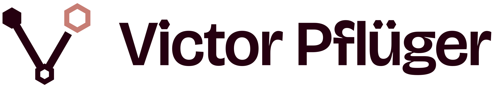

<p align="center">
  
</p>

<h1 align="center">Vici Design System</h1>

<p align="center">
  A personal design system for prototypes, websites and data products.<br>
  Hexagons instead of circles · merlot <code>#250010</code> with pastel families · light and dark themes · one stylesheet, no build step.
</p>

---

## Quick start

```html
<link rel="stylesheet" href="https://cdn.jsdelivr.net/gh/VictorPflueger/ViciDesign@main/dist/vici.min.css">
<script src="https://cdn.jsdelivr.net/gh/VictorPflueger/ViciDesign@main/dist/vici.js" defer></script>

<button class="vc-button">Primary action</button>
<span class="vc-avatar">VP</span>
```

Pin a release tag (`@v1.0.0`) instead of `@main` for anything that has to stay stable. For offline work or sites that must not
load third-party resources, copy `dist/` and `assets/fonts/` into the project and keep their relative positions.

The documentation site, with live demos and copyable code for every component, is published at
**https://victorpflueger.github.io/ViciDesign/** (GitHub Pages, from the root of `main`). It also works offline: open
`index.html` locally.

## The concept

| | |
|---|---|
| **Cells, not circles** | Anything that would be round is a flat-top hexagon: avatars, radios, switch knobs, slider thumbs, badges, spinners, progress rings, pagination, steppers, bullets, rating cells and the round parts of every icon. Pills become *hex capsules* with pointed ends. Rectangles keep small radii. |
| **Deep base, soft light** | Merlot `#250010` is the ink in light mode, the fill of primary actions and the canvas in dark mode. Eight OKLCH-generated families (merlot, coral, apricot, honey, sage, teal, fjord, lilac) plus linen neutrals carry meaning, and their pastel steps carry the atmosphere. |
| **Data first** | Tabular figures everywhere numbers live, a categorical chart palette checked against colour-blindness simulations, KPI cards, sortable tables, SVG chart examples. |
| **Zero friction** | Plain CSS in cascade layers plus a small optional script. Plain HTML is styled without classes. No framework, no dependencies. |
| **Accessible by default** | Every semantic colour pair meets WCAG 2.2 AA in both themes (verified by `npm run check`). Visible focus everywhere, hexagonal on hexagon controls, reduced-motion support, Windows contrast themes, text that scales with the reader's settings, and reflow down to 320 px. |

## What's inside

- **Guidelines:** principles, colour and colour coding, typography, hexagon geometry, layout and spacing, elevation, motion, iconography, data visualisation, accessibility.
- **Components:** button, icon button, toggle and button group, link, segmented control · field, text input, textarea, select, combobox, date/number/file inputs, checkbox, radio, switch, slider, chip, rating · card, accordion, list and list group, divider, tag, badge, avatar and avatar group, presence, timeline, honeycomb tile, code block · header, side navigation, footer, tabs, breadcrumb, pagination, stepper, carousel · alert and banner, callout, toast, tooltip, progress bar, hex progress, spinner, skeleton, empty state · dialog, drawer, menu, popover · table, stat card, sparkline, legend, chart frame.
- **Brand:** the Vertex logo with lockups, app icon and favicon, the wordmark, five monogram options to choose from, and a guideline for profile links: a "Built by" byline with a hexagon portrait, profile links in footers and contact sections, and how to treat other brands' logos.
- **Starters:** an app prototype, a data dashboard, a personal landing page and a blank page in `starters/`.
- **Integrations:** Streamlit theme and byline helper, Power BI theme, Python palette for matplotlib/plotly, Tailwind CSS v4 theme, all generated from the same tokens.
- **Icons:** 64 original line icons on a 24 px grid. Every round form in them is drawn as a hexagon, and arrowheads and chevrons open at the hexagon's 120° angle. Even password masks are hexagons.

## Typography

| Role | Typeface | Licence |
|---|---|---|
| Display: headlines, KPIs, wordmark | Bricolage Grotesque (variable: weight + optical size) | SIL OFL 1.1 |
| Text and UI | Inter (variable: weight + optical size, italic) | SIL OFL 1.1 |
| Code and data | JetBrains Mono (variable: weight) | SIL OFL 1.1 |

All fonts are self-hosted in `assets/fonts/`, so no font is requested from a third-party server.

## Repository layout

```
dist/                 vici.css · vici.min.css · vici-tokens.css · vici.js · vici-icons.svg · tokens.json   (generated)
assets/fonts/         WOFF2 files + OFL licences, vici-mask.woff2 (hexagon password mask)
assets/logo/          Vertex logo, wordmarks, monogram options, archived concepts as SVG                 (generated)
assets/marks/         other brands' logos for profile links (GitHub's Invertocat, LinkedIn's [in] logo), unchanged
assets/brand/         Victor Pflüger's portrait (original and a 96 px copy)
src/tokens/           tokens.json — the single source of truth (DTCG-style)
src/css/              base, shape (hexagon geometry), layout, utilities, forced colours, components/*.css
src/js/vici.js        optional behaviours
src/icons/            one SVG per icon
src/docs/             documentation page sources, layout, docs styles
src/starters/         starter page sources
src/brand/            outlined wordmark paths
scripts/              build.mjs, palette.mjs, checks, brand/wordmark.py, brand/mask-font.py
integrations/         Streamlit, Power BI, Python, Tailwind                                            (generated)
index.html, start/, guidelines/, components/, brand/, starters/   documentation site                   (generated)
```

## Working on Vici

Requires Node 18+. There are no dependencies to install.

```sh
node scripts/build.mjs      # regenerate dist/, docs pages, logos and integrations
npm run check               # contrast, hexagon rule, fonts, links, logos, exports, build freshness
npm run palette             # after editing scripts/palette.mjs: regenerate the colour ramps and rebuild
npm run check:render        # optional: render every page in Chromium (needs Playwright)
python3 scripts/brand/wordmark.py   # after changing the wordmarks (needs fonttools, uharfbuzz, skia-pathops, shapely)
python3 scripts/brand/mask-font.py  # regenerates the hexagon password-mask font (needs fonttools, brotli)
python3 scripts/brand/portrait.py   # after replacing assets/brand/portrait.jpg: makes the 96 px copy (needs Pillow)
```

Generated files are committed, so the CDN links and GitHub Pages work without a build server. `npm run check` fails if a
generated file is stale.

## Licence

- **Code, tokens, icons and documentation:** MIT. Use them in your own projects, commercial or not, and keep the
  copyright notice.
- **Victor Pflüger's personal brand:** his name as a mark, his portrait (`assets/brand/`), the Vertex logo, the monogram
  options and the wordmarks (`assets/logo/`, `src/brand/`) are all rights reserved. If you build on Vici, put your own
  name, photo and logo in their place.
- **Fonts:** Bricolage Grotesque, Inter and JetBrains Mono are under the SIL Open Font License 1.1 (`assets/fonts/OFL-*.txt`).
- **Other brands:** GitHub's Invertocat and LinkedIn's [in] logo in `assets/marks/` belong to GitHub and LinkedIn and are
  used unchanged, only to link to profiles, as their brand guidelines allow.

The full terms are in [LICENSE](LICENSE).
